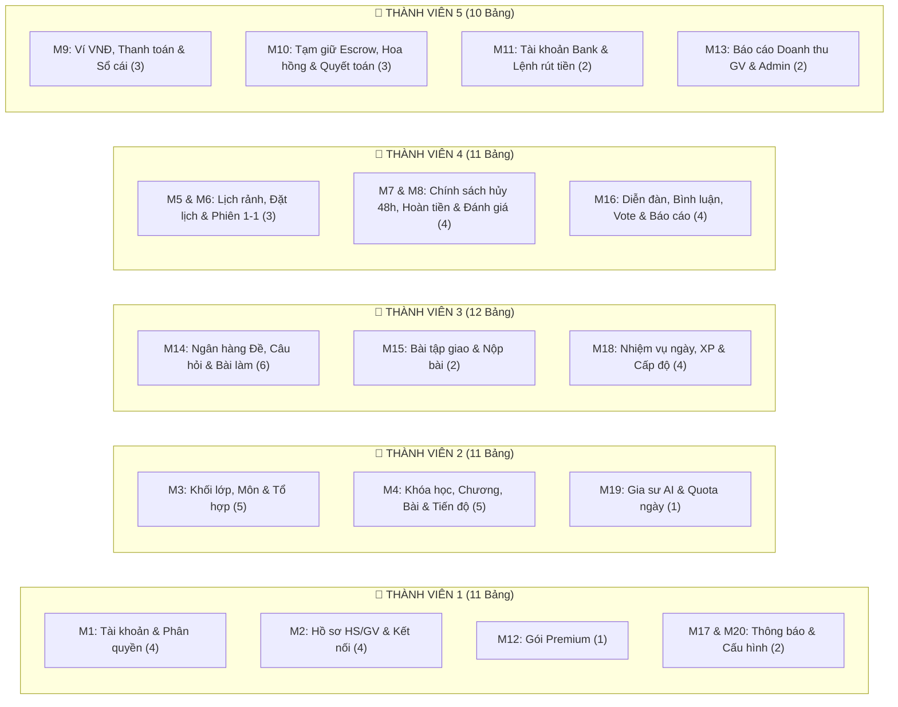

# BẢN PHÂN CÔNG NHIỆM VỤ
**Tổng quy mô:** 55 Thực thể UML • 72 Quan hệ kết hợp • 8 Quan hệ phụ thuộc • 20 Phân hệ chức năng

---

## 1. Bảng Tổng Hợp Cân Bằng Khối Lượng Công Việc (5 Thành Viên)

| Thành viên | Chức danh / Cụm Nghiệp vụ | Số bảng UML | Số Module | Tỷ trọng Công việc |
| :--- | :--- | :---: | :---: | :---: |
| **Thành viên 1 (TV1)** | Định danh, Phân quyền, Hồ sơ Năng lực, Premium, Thông báo & Cấu hình | **11 bảng** | 5 Modules *(3.1, 3.2, 3.12, 3.17, 3.20)* | **20%** |
| **Thành viên 2 (TV2)** | Học thuật, Tổ hợp Môn, Khóa học Tri thức (E-Learning) & Trợ lý AI Tutor | **11 bảng** | 3 Modules lớn *(3.3, 3.4, 3.19)* | **20%** |
| **Thành viên 3 (TV3)** | Khảo thí, Ngân hàng Đề, Phòng thi Tính giờ, Bài tập Giao & Gamification XP | **12 bảng** | 3 Modules lớn *(3.14, 3.15, 3.18)* | **20%** |
| **Thành viên 4 (TV4)** | Gia sư 1-1, Đặt lịch, Phòng học Live, Hủy lịch 48h, Đánh giá & Cộng đồng | **11 bảng** | 5 Modules *(3.5, 3.6, 3.7, 3.8, 3.16)* | **20%** |
| **Thành viên 5 (TV5)** | Tài chính Ví VNĐ, Thanh toán VietQR, Ký quỹ Escrow, Hoa hồng & Báo cáo | **10 bảng** | 4 Modules *(3.9, 3.10, 3.11, 3.13)* | **20%** |
| **TỔNG CỘNG** | **Toàn bộ Hệ thống DONET ACADEMY** | **55 bảng** | **20 / 20 Modules** | **100%** |

---

## 2. Đặc Tả Nhiệm Vụ Chi Tiết Từng Thành Viên (Từ Database $\to$ Backend $\to$ Frontend)

### 👤 THÀNH VIÊN 1 (TV1): ĐỊNH DANH, HỒ SƠ NĂNG LỰC, GÓI PREMIUM, THÔNG BÁO & CẤU HÌNH

#### A. Các bảng Database phụ trách (11 bảng):
1. **`TaiKhoan` (`ApplicationUser : IdentityUser<int>`)**: `MaTaiKhoan [PK]`, `Email [UQ]`, `MatKhauHash`, `EmailDaXacMinh`, `TrangThai`, `LyDoKhoa`, `SecurityStamp`.
2. **`VaiTro` (`ApplicationRole : IdentityRole<int>`)**: `MaVaiTro [PK]`, `TenVaiTro` (`HocSinh`, `GiaoVien`, `Admin`), `MoTa`.
3. **`TaiKhoan_VaiTro`**: `MaTaiKhoan [PK, FK]`, `MaVaiTro [PK, FK]` (Khóa chính kép N:N).
4. **`NguoiDung`**: `MaNguoiDung [PK]`, `MaTaiKhoan [FK, UQ]`, `HoTen`, `SoDienThoai`, `AnhDaiDien`, `NgaySinh`, `GioiTinh`, `DiaChi`, `Timezone`.
5. **`HoSoHocSinh`**: `MaHoSo [PK, FK]`, `MaKhoi [FK]`, `MaCap [FK]`, `MaGoiPremium [FK, NULL]`, `TongXP`, `SoNgayHocLienTiep`, `ChuoiNgayHoc`, `NgayHetHanPremium`, `RowVersion [Timestamp]`.
6. **`HoSoGiaoVien`**: `MaHoSo [PK, FK]`, `ChuyenMon`, `URLHoSo`, `TrangThaiXacThuc` (`ChoDuyet`, `DaDuyet`, `TuChoi`), `NgayDuocThiLai`, `NguoiDuyet [FK, NULL]`, `LyDoTuChoi`, `RowVersion [Timestamp]`.
7. **`GiaoVien_MonHoc`**: `MaGiaoVien [PK, FK]`, `MaMon [PK, FK]`, `TrinhDo`, `GiaTienMoiGio`, `TrangThaiDuyet` (Khóa chính kép).
8. **`TheoDoi`**: `MaHocSinh [PK, FK]`, `MaGiaoVien [PK, FK]`, `NgayTheoDoi` (Khóa chính kép).
9. **`GoiPremium`**: `MaGoi [PK]`, `TenGoi`, `GiaVND (bigint/decimal)`, `SoNgay`, `MoTa`, `UuDai`.
10. **`ThongBao`**: `MaThongBao [PK]`, `MaNguoiDung [FK]`, `TieuDe`, `NoiDung`, `LinkLienKet`, `NgayTao`, `DaDoc`.
11. **`CauHinhHeThong`**: `MaCauHinh [PK]`, `Khoa`, `GiaTri`, `MoTa`.

#### B. Các phương thức UML & Logic Nghiệp vụ cần code:
* `TaiKhoan.dangNhap()`, `TaiKhoan.doiMatKhau()`: Xác thực bằng ASP.NET Core Identity, kiểm tra tài khoản bị khóa (`TrangThai`, `LyDoKhoa`), làm mới `SecurityStamp` khi đổi mật khẩu.
* `HoSoGiaoVien.dangKyMonDay()`: Giáo viên đăng ký môn dạy và trình độ; chỉ được mở ca dạy khi `TrangThaiDuyet == DaDuyet`.
* **Luồng Admin duyệt hồ sơ giáo viên:** Xem chứng chỉ PDF, bấm Approve (cập nhật `TrangThaiXacThuc`, ghi nhận `NguoiDuyet`) hoặc Reject (ghi `LyDoTuChoi` và `NgayDuocThiLai`).
* **Luồng Gói Premium & Theo dõi:** Học sinh đăng ký `GoiPremium` (cập nhật `NgayHetHanPremium`), bấm `TheoDoi` / Bỏ theo dõi giáo viên.
* **Luồng Thông báo Realtime:** Lưu `ThongBao` vào DB, dùng SignalR (`NotificationHub`) đẩy thông báo tức thời lên chuông thông báo và đánh dấu `DaDoc`.

#### C. Các file trong Project thuộc phạm vi của TV1:
* **Entities:** [IdentityEntities.cs](file:///d:/CODE%20programe/DOTNET%20Pj/DONET_Academy_Project/DONET_Academy.Core/Entities/IdentityEntities.cs)
* **Views & Controllers:**
  * [Views/Shared/_AuthModal.cshtml](file:///d:/CODE%20programe/DOTNET%20Pj/DONET_Academy_Project/DONET_Academy.Web/Views/Shared/_AuthModal.cshtml)
  * [Areas/Admin/Controllers/AccountController.cs](file:///d:/CODE%20programe/DOTNET%20Pj/DONET_Academy_Project/DONET_Academy.Web/Areas/Admin/Controllers/AccountController.cs) & [Areas/Admin/Views/Account/Login.cshtml](file:///d:/CODE%20programe/DOTNET%20Pj/DONET_Academy_Project/DONET_Academy.Web/Areas/Admin/Views/Account/Login.cshtml)
  * [Views/Home/Pricing.cshtml](file:///d:/CODE%20programe/DOTNET%20Pj/DONET_Academy_Project/DONET_Academy.Web/Views/Home/Pricing.cshtml)
  * [Areas/Admin/Views/Users/Index.cshtml](file:///d:/CODE%20programe/DOTNET%20Pj/DONET_Academy_Project/DONET_Academy.Web/Areas/Admin/Views/Users/Index.cshtml)
  * [Areas/Admin/Views/TeacherVerifications/Index.cshtml](file:///d:/CODE%20programe/DOTNET%20Pj/DONET_Academy_Project/DONET_Academy.Web/Areas/Admin/Views/TeacherVerifications/Index.cshtml)
  * [Areas/Admin/Views/Settings/Index.cshtml](file:///d:/CODE%20programe/DOTNET%20Pj/DONET_Academy_Project/DONET_Academy.Web/Areas/Admin/Views/Settings/Index.cshtml)

---

### 👤 THÀNH VIÊN 2 (TV2): HỌC THUẬT, TỔ HỢP MÔN, KHÓA HỌC TRI THỨC (E-LEARNING) & TRỢ LÝ AI TUTOR

#### A. Các bảng Database phụ trách (11 bảng):
1. **`KhoiLop`**: `MaKhoi [PK]`, `TenKhoi` (Lớp 10, 11, 12), `ThuTu`.
2. **`MonHoc`**: `MaMon [PK]`, `TenMon` (Toán, Lí, Hóa, Sinh, Anh...), `NhomMon`, `MoTa`, `MaKhoiLop [FK]`, `IconName`, `TrangThai`.
3. **`ToHopHocTap` (`ToHopMon`)**: `MaToHop [PK]`, `TenToHop` (A00, B00, D01...), `Loai` (`MAC_DINH` / `TU_TAO`), `MaNguoiTao [FK, NULL]`, `MoTa`, `TrangThai`.
4. **`ToHop_MonHoc`**: `MaToHop [PK, FK]`, `MaMon [PK, FK]`, `ThuTu` (Khóa chính kép).
5. **`HocSinh_ToHop`**: `MaHocSinh [PK, FK]`, `MaToHop [PK, FK]`, `NgayChon`, `LaToHopChinh` (Khóa chính kép).
6. **`KhoaHocTriThuc`**: `MaKhoaHoc [PK]`, `MaMon [FK]`, `MaKhoiLop [FK]`, `TieuDe`, `MoTa`, `GiaVND (bigint/decimal)`, `HinhAnh`, `TrangThai`, `NgayTao`.
7. **`ChuongHoc`**: `MaChuong [PK]`, `MaKhoaHoc [FK]`, `TenChuong`, `ThuTu`.
8. **`BaiHoc`**: `MaBai [PK]`, `MaChuong [FK]`, `TenBai`, `VideoUrl`, `NoiDung`, `ThoiLuongPhut`, `ThuTu`, `MienPhiXemTruoc`.
9. **`DangKyKhoaHoc`**: `MaDangKy [PK]`, `MaHocSinh [FK]`, `MaKhoaHoc [FK]`, `GiaChotVND (bigint/decimal)`, `NgayMua`, `TrangThai`.
10. **`TienDoBaiHoc`**: `MaTienDo [PK]`, `MaBai [FK]`, `MaHocSinh [FK]`, `DaHoanThanh`, `ThoiGianHocGiay`, `NgayCapNhat` (Ràng buộc Unique trên cặp `MaBai` + `MaHocSinh`).
11. **`QuotaAI`**: `MaQuota [PK]`, `MaHocSinh [FK]`, `NgaySuDung (date)`, `SoTinNhanDaDung`, `SoLuotToiDaNgay`.

#### B. Các phương thức UML & Logic Nghiệp vụ cần code:
* `ToHopHocTap.themMon()`, `ToHopHocTap.xoaMon()`, `HoSoHocSinh.chonToHop()`: Cho phép học sinh chọn tổ hợp mặc định (không được xóa/sửa) hoặc tự tạo tổ hợp riêng (`TU_TAO`), đánh dấu duy nhất 1 tổ hợp có `LaToHopChinh = true`.
* `DangKyKhoaHoc.dangKy()`: Mua khóa học tri thức, chốt cứng giá tại thời điểm mua (`GiaChotVND`), gọi sang `WalletService.TruTien()` để ghi bút toán `TRU` vào `GiaoDichVi`.
* **Cây bài giảng & Tiến độ học:** Hiển thị cấu trúc `KhoaHocTriThuc` $\to$ `ChuongHoc` $\to$ `BaiHoc`. Khi học sinh học xong bài, cập nhật `TienDoBaiHoc.DaHoanThanh = true` và tính % hoàn thành khóa học.
* **Trợ lý AI Tutor & Kiểm soát Quota:** Mỗi lần học sinh gửi câu hỏi cho AI Tutor, kiểm tra `QuotaAI` theo `NgaySuDung = DateTime.Today`. Nếu chưa vượt `SoLuotToiDaNgay` thì tăng `SoTinNhanDaDung` và trả lời; nếu hết lượt thì thông báo nâng cấp `GoiPremium`.

#### C. Các file trong Project thuộc phạm vi của TV2:
* **Entities:** [AcademicEntities.cs](file:///d:/CODE%20programe/DOTNET%20Pj/DONET_Academy_Project/DONET_Academy.Core/Entities/AcademicEntities.cs)
* **Views & Controllers:**
  * [Controllers/HomeController.cs](file:///d:/CODE%20programe/DOTNET%20Pj/DONET_Academy_Project/DONET_Academy.Web/Controllers/HomeController.cs) & [Views/Home/Index.cshtml](file:///d:/CODE%20programe/DOTNET%20Pj/DONET_Academy_Project/DONET_Academy.Web/Views/Home/Index.cshtml)
  * [Areas/Student/Views/Courses/Index.cshtml](file:///d:/CODE%20programe/DOTNET%20Pj/DONET_Academy_Project/DONET_Academy.Web/Areas/Student/Views/Courses/Index.cshtml)
  * [Areas/Student/Views/AiTutor/Index.cshtml](file:///d:/CODE%20programe/DOTNET%20Pj/DONET_Academy_Project/DONET_Academy.Web/Areas/Student/Views/AiTutor/Index.cshtml)

---

### 👤 THÀNH VIÊN 3 (TV3): KHẢO THÍ, NGÂN HÀNG ĐỀ THI, PHÒNG THI TÍNH GIỜ, BÀI TẬP GIAO & GAMIFICATION XP

#### A. Các bảng Database phụ trách (12 bảng):
1. **`BoDe`**: `MaBoDe [PK]`, `MaMon [FK]`, `TenBoDe`, `ThoiGianLamBai (phút)`, `SoCauHoi`, `DiemToiDa`, `DaXuatBan`, `NgayTao`.
2. **`ChiTietDe`**: `MaBoDe [PK, FK]`, `MaCauHoi [PK, FK]`, `ThuTu`, `DiemCau` (Khóa chính kép).
3. **`CauHoi`**: `MaCauHoi [PK]`, `LoaiCauHoi` / `MucDo`, `NoiDung`, `HinhAnh`, `GiaiThich`.
4. **`DapAn`**: `MaDapAn [PK]`, `MaCauHoi [FK]`, `NoiDung`, `LaDapAnDung (bool)`, `ThuTu`.
5. **`BaiLam`**: `MaBaiLam [PK]`, `MaBoDe [FK]`, `MaHocSinh [FK]`, `BatDauLuc`, `NopLuc [NULL]`, `Diem`, `SoCauDung`, `DaNop`, `TrangThai`.
6. **`ChiTietBaiLam`**: `MaChiTiet [PK]`, `MaBaiLam [FK]`, `MaCauHoi [FK]`, `MaDapAnChon [FK, NULL]`, `DungSai (bool)`, `DiemDatDuoc` (Ràng buộc Unique trên cặp `MaBaiLam` + `MaCauHoi`).
7. **`BaiTapGiao`**: `MaBaiTap [PK]`, `MaGiaoVien [FK]`, `MaBoDe [FK, NULL]`, `MaMon [FK]`, `TieuDe`, `HanNop`, `GhiChu`.
8. **`NopBaiTap`**: `MaNopBai [PK]`, `MaBaiTap [FK]`, `MaHocSinh [FK]`, `MaBaiLam [FK, NULL]`, `NgayNop`, `DiemSo`, `NhanXetGiaoVien`.
9. **`MauNhiemVu`**: `MaMau [PK]`, `TenNhiemVu`, `LoaiDieuKien`, `MucTieu`, `PhanThuongXP`, `IconName`.
10. **`NhiemVuNgay`**: `MaNVNgay [PK]`, `MaMau [FK]`, `NgayGiao (date)`, `SoLuongYeuCau`.
11. **`TienDoNhiemVu`**: `MaHocSinh [PK, FK]`, `MaNVNgay [PK, FK]`, `GiaTriHienTai`, `DaHoanThanh`, `DaNhanThuongXP` (Khóa chính kép).
12. **`CapDo`**: `MaCap [PK]`, `TenCap`, `DiemXPYeuCau`, `IconHuyHieu`.

#### B. Các phương thức UML & Logic Nghiệp vụ cần code:
* **Soạn câu hỏi & Ghép bộ đề (Giáo viên):** CRUD câu hỏi 4 đáp án (`CauHoi`, `DapAn`), chọn câu hỏi đưa vào `BoDe` thông qua `ChiTietDe` có đánh số `ThuTu`.
* **Phòng thi trắc nghiệm tính giờ (Học sinh):**
  * Khi bắt đầu thi: Tạo `BaiLam` với `BatDauLuc = DateTime.UtcNow`.
  * Trên trình duyệt: Chạy đồng hồ đếm ngược (`exam-timer.js`) và tự động lưu nháp đáp án vào `localStorage` (`exam-draft.js`).
  * Khi bấm Nộp bài: Server kiểm tra hạn giờ (`BatDauLuc + ThoiGianLamBai`), chống nộp lặp (`DaNop`), đối chiếu `DapAn.LaDapAnDung`, lưu `ChiTietBaiLam`, tính `TongDiem` và trả về màn hình giải thích đáp án.
* **Giao bài tập & Chấm bài:** Giáo viên tạo `BaiTapGiao` (có thể đính kèm `MaBoDe` hoặc tự luận) với `HanNop`. Học sinh nộp `NopBaiTap` (kiểm tra nộp đúng hạn hay trễ hạn). Giáo viên chấm điểm và ghi nhận xét.
* **Vòng lặp Gamification (Nhiệm vụ & XP):** Khi học sinh hoàn thành đề thi hoặc nộp bài tập, tự động tăng `TienDoNhiemVu.GiaTriHienTai`. Khi bấm "Nhận thưởng XP" (`DaNhanThuongXP = true`), cộng `PhanThuongXP` vào `HoSoHocSinh.TongXP` và tự động nâng `MaCap` nếu đạt mốc `CapDo.DiemXPYeuCau`.

#### C. Các file trong Project thuộc phạm vi của TV3:
* **Entities:** [ExaminationEntities.cs](file:///d:/CODE%20programe/DOTNET%20Pj/DONET_Academy_Project/DONET_Academy.Core/Entities/ExaminationEntities.cs) & nhóm bảng Nhiệm vụ trong [GamificationCommunityEntities.cs](file:///d:/CODE%20programe/DOTNET%20Pj/DONET_Academy_Project/DONET_Academy.Core/Entities/GamificationCommunityEntities.cs)
* **Views & Controllers:**
  * [Areas/Student/Views/Dashboard/Index.cshtml](file:///d:/CODE%20programe/DOTNET%20Pj/DONET_Academy_Project/DONET_Academy.Web/Areas/Student/Views/Dashboard/Index.cshtml)
  * [Areas/Student/Views/Exams/Index.cshtml](file:///d:/CODE%20programe/DOTNET%20Pj/DONET_Academy_Project/DONET_Academy.Web/Areas/Student/Views/Exams/Index.cshtml)
  * [Areas/Student/Views/Assignments/Index.cshtml](file:///d:/CODE%20programe/DOTNET%20Pj/DONET_Academy_Project/DONET_Academy.Web/Areas/Student/Views/Assignments/Index.cshtml)
  * [Areas/Student/Views/Missions/Index.cshtml](file:///d:/CODE%20programe/DOTNET%20Pj/DONET_Academy_Project/DONET_Academy.Web/Areas/Student/Views/Missions/Index.cshtml)
  * [Areas/Teacher/Views/ExamBank/Index.cshtml](file:///d:/CODE%20programe/DOTNET%20Pj/DONET_Academy_Project/DONET_Academy.Web/Areas/Teacher/Views/ExamBank/Index.cshtml)
  * [Areas/Teacher/Views/Grading/Index.cshtml](file:///d:/CODE%20programe/DOTNET%20Pj/DONET_Academy_Project/DONET_Academy.Web/Areas/Teacher/Views/Grading/Index.cshtml)

---

### 👤 THÀNH VIÊN 4 (TV4): GIA SƯ 1-1, ĐẶT LỊCH, PHÒNG HỌC LIVE, HỦY LỊCH 48H, ĐÁNH GIÁ & CỘNG ĐỒNG

#### A. Các bảng Database phụ trách (11 bảng):
1. **`LichRanhGiaoVien`**: `MaLich [PK]`, `MaGiaoVien [FK]`, `MaMon [FK]`, `BatDau`, `KetThuc`, `GiaBuoiVND (bigint/decimal)`, `TrangThai`, `RowVersion [Timestamp]`.
2. **`DatLich`**: `MaDatLich [PK]`, `MaHocSinh [FK]`, `MaLich [FK, UQ]`, `MaCSHuy [FK]`, `GiaChotVND (bigint/decimal)`, `NgayDat`, `TrangThai`, `NguoiHuy [FK, NULL]`.
3. **`PhienHoc1V1`**: `MaPhien [PK]`, `MaDatLich [FK, UQ]`, `MaPhong`, `GioVaoHocSinh`, `GioVaoGiaoVien`, `BatDauThucTe`, `KetThucThucTe`, `DaHoanThanhNghiemThu`, `TrangThai`.
4. **`ChinhSachHuy`**: `MaCSHuy [PK]`, `TenChinhSach`, `SoGioBaoTruoc (= 48)`, `TiLeHoanDungHan (= 100)`, `HieuLucTu`, `TrangThai`.
5. **`YeuCauHuyBuoi`**: `MaYeuCau [PK]`, `MaDatLich [FK, UQ]`, `MaNguoiDungHuy`, `NgayYeuCau`, `LyDo`, `DungHan (bool)`, `SoTienDuocHoan`, `TrangThai`, `NguoiDuyet [FK, NULL]`.
6. **`HoanTien`**: `MaHoanTien [PK]`, `MaYeuCau [FK, UQ]`, `MaGiaoDichVi [FK, UQ]`, `SoTienHoanVND (bigint/decimal)`, `NgayHoan`, `TrangThai`.
7. **`DanhGia`**: `MaDanhGia [PK]`, `MaDatLich [FK, UQ]`, `SoSao (1..5)`, `NhanXet`, `NgayTao`.
8. **`BaiDang`**: `MaBaiDang [PK]`, `MaNguoiDung [FK]`, `TieuDe`, `NoiDung`, `DiemVote`, `LuotXem`, `NgayDang`, `DaXoaAn (bool)`.
9. **`BinhLuan`**: `MaBinhLuan [PK]`, `MaBaiDang [FK]`, `MaNguoiDung [FK]`, `NoiDung`, `NgayBinhLuan`, `DaXoaAn (bool)`.
10. **`Vote`**: Khóa chính kép `(MaBaiDang [PK, FK], MaNguoiDung [PK, FK])`, `GiaTriVote (+1 / -1)`.
11. **`BaoCaoViPham`**: `MaBaoCao [PK]`, `LoaiDoiTuong`, `DoiTuongID`, `MaNguoiBaoCao [FK]`, `LyDo`, `NgayTao`, `TrangThai`, `AdminXuLy [FK, NULL]`.

#### B. Các phương thức UML & Logic Nghiệp vụ cần code:
* `LichRanhGiaoVien.capNhatLich()`: Giáo viên mở ca dạy rảnh hoặc sửa giờ/giá khi ca chưa có người đặt. Sử dụng `RowVersion` để chống 2 học sinh đặt trùng cùng 1 ca dạy.
* `DatLich.xacNhan()`: Học sinh chọn ca rảnh $\to$ Kiểm tra `MaLich [UQ]` chưa bị đặt $\to$ Chốt `GiaChotVND`, gắn `MaCSHuy` $\to$ Gọi sang `WalletService` để trừ ví và tạo `KhoanTamGiu` $\to$ Khởi tạo `PhienHoc1V1`.
* `DatLich.huyLich()`, `YeuCauHuyBuoi.guiYeuCau()`, `ChinhSachHuy.duDieuKienHoan()`, `HoanTien.hoanVeVi()`:
  * So sánh `(LichRanh.BatDau - NgayYeuCau).TotalHours >= ChinhSachHuy.SoGioBaoTruoc (48h)`.
  * **Nếu hủy đúng hạn ($\ge 48h$):** `DungHan = true`, hoàn **100%** `GiaChotVND` về ví học sinh qua bảng `HoanTien` và bút toán `HOAN` trong `GiaoDichVi`.
  * **Nếu hủy muộn ($< 48h$):** `DungHan = false`, hoàn **0%** cho học sinh, giải phóng `KhoanTamGiu` quyết toán đền bù cho giáo viên.
* **Quản lý `PhienHoc1V1` & Đánh giá `DanhGia`:** Ghi nhận giờ vào phòng học của HS & GV, bấm hoàn thành nghiệm thu buổi học (hoặc tự động nghiệm thu sau giờ kết thúc + 2 tiếng) để kích hoạt `quyetToan()`. Học sinh chấm 1–5 sao (`DanhGia.MaDatLich [UQ]`).
* **Diễn đàn Cộng đồng & Kiểm duyệt:** Đăng câu hỏi (`BaiDang`), trả lời (`BinhLuan`), bình chọn (`Vote` mỗi người 1 phiếu, cập nhật `DiemVote`), gửi `BaoCaoViPham` và Admin ẩn mềm (`DaXoaAn = true`).

#### C. Các file trong Project thuộc phạm vi của TV4:
* **Entities:** [TutoringEntities.cs](file:///d:/CODE%20programe/DOTNET%20Pj/DONET_Academy_Project/DONET_Academy.Core/Entities/TutoringEntities.cs) & nhóm bảng Cộng đồng trong [GamificationCommunityEntities.cs](file:///d:/CODE%20programe/DOTNET%20Pj/DONET_Academy_Project/DONET_Academy.Core/Entities/GamificationCommunityEntities.cs)
* **Views & Controllers:**
  * [Areas/Student/Views/Tutors/Index.cshtml](file:///d:/CODE%20programe/DOTNET%20Pj/DONET_Academy_Project/DONET_Academy.Web/Areas/Student/Views/Tutors/Index.cshtml)
  * [Areas/Student/Views/Community/Index.cshtml](file:///d:/CODE%20programe/DOTNET%20Pj/DONET_Academy_Project/DONET_Academy.Web/Areas/Student/Views/Community/Index.cshtml)
  * [Areas/Teacher/Views/Schedule/Index.cshtml](file:///d:/CODE%20programe/DOTNET%20Pj/DONET_Academy_Project/DONET_Academy.Web/Areas/Teacher/Views/Schedule/Index.cshtml)
  * [Areas/Teacher/Views/Classrooms/Index.cshtml](file:///d:/CODE%20programe/DOTNET%20Pj/DONET_Academy_Project/DONET_Academy.Web/Areas/Teacher/Views/Classrooms/Index.cshtml)

---

### 👤 THÀNH VIÊN 5 (TV5): TÀI CHÍNH VÍ VNĐ, THANH TOÁN VIETQR, KÝ QUỸ ESCROW, CHIA HOA HỒNG 80/20, RÚT TIỀN & BÁO CÁO DOANH THU

#### A. Các bảng Database phụ trách (10 bảng):
1. **`ViTien`**: `MaVi [PK]`, `MaNguoiDung [FK, UQ]`, `SoDuKhaDungVND (bigint/decimal)`, `SoDuDongBang`, `NgayCapNhat`, `RowVersion [Timestamp]`.
2. **`GiaoDichThanhToan`**: `MaGiaoDich [PK]`, `MaVi [FK]`, `MaGiaoDichCong [UQ]`, `SoTienVND (bigint/decimal)`, `CongThanhToan`, `PhuongThuc`, `TrangThai`, `NgayTao`.
3. **`GiaoDichVi`**: `MaGDVi [PK]`, `MaVi [FK]`, `Loai` (`NAP`, `TRU`, `HOAN`, `NHAN`, `RUT`), `SoTienVND (bigint/decimal)`, `Chieu` (`CONG` / `TRU`), `SoDuTruoc`, `SoDuSau`, `ThamChieuLoai`, `ThamChieuID`, `IdempotencyKey [UQ]`, `NgayTao`.
4. **`KhoanTamGiu`**: `MaTamGiu [PK]`, `MaDatLich [FK, UQ]`, `SoTienVND (bigint/decimal)`, `TrangThai` / `DaGiaiPhong`, `NgayTao`.
5. **`ChinhSachHoaHong`**: `MaCSHoaHong [PK]`, `TenChinhSach`, `TyLeGiaoVien (= 80)`, `TyLeNenTang (= 20)`, `HieuLucTu`, `HieuLucDen [NULL]`, `HieuLuc`.
6. **`PhanChiaDoanhThu`**: `MaPhanChia [PK]`, `MaTamGiu [FK, UQ]`, `MaCSHoaHong [FK]`, `TongTien`, `TienGiaoVienVND (bigint/decimal)`, `TienNenTangVND (bigint/decimal)`, `NgayQuyetToan`, `TrangThai`.
7. **`TaiKhoanNhanTien`**: `MaTKBank [PK]`, `MaGiaoVien [FK]`, `TenNganHang`, `SoTaiKhoanAn`, `TenChuTaiKhoan`, `ProviderToken`, `MacDinh`.
8. **`LenhRutTien`**: `MaLenh [PK]`, `MaGiaoVien [FK]`, `MaTKBank [FK]`, `SoTienRutVND (bigint/decimal)`, `NgayTao`, `NgayXuLy [NULL]`, `AdminXuLy [FK, NULL]`, `LyDoTuChoi`, `TrangThai`.
9. **`BaoCaoDoanhThuGiaoVien` (`<<VIEW>>`)**: `MaBaoCao [PK]`, `MaGiaoVien [FK]`, `Thang`, `Nam`, `TongDoanhThuVND`, `TongDuocChiaVND`, `SoDuCoTheRutVND`, `SoBuoiDay`.
10. **`BaoCaoDoanhThuAdmin` (`<<VIEW>>`)**: `MaBaoCao [PK]`, `NgayBaoCao`, `TongNapTienVND`, `TongPhiNenTangVND`, `TongHoanTienVND`, `TongChiTraGVVND`.

#### B. Các phương thức UML & Logic Nghiệp vụ cần code:
* `ViTien.napTien()`, `GiaoDichThanhToan.xacThucWebhook()`, `GiaoDichVi.ghiSo()`:
  * Học sinh chọn mệnh giá nạp VietQR $\to$ Tạo `GiaoDichThanhToan` với `MaGiaoDichCong [UQ]`.
  * Khi xác thực webhook thành công (`«khi nạp thành công»`): Kiểm tra `IdempotencyKey [UQ]` chống cộng tiền 2 lần, ghi bút toán `NAP` (`Chieu = CONG`) vào `GiaoDichVi` và cộng `SoDuKhaDungVND` trong `ViTien` (bảo vệ bằng Database Transaction & `RowVersion`).
* `ViTien.truTien()`: Kiểm tra `SoDuKhaDungVND >= SoTien`, trừ số dư và ghi bút toán `TRU` (`Chieu = TRU`) kèm `ThamChieuLoai` (`DangKyKhoaHoc` hoặc `DatLich`).
* `KhoanTamGiu.giaiPhongTien()`, `PhanChiaDoanhThu.quyetToan()`:
  * Khi buổi học 1-1 hoàn tất nghiệm thu: Giải phóng `KhoanTamGiu` (`PhanChiaDoanhThu.MaTamGiu [UQ]`), áp dụng `ChinhSachHoaHong` đang hiệu lực (mặc định **80% Giáo viên / 20% Nền tảng**), đảm bảo `TienGiaoVienVND + TienNenTangVND == KhoanTamGiu.SoTienVND`.
  * Kích hoạt quan hệ phụ thuộc `«ghi có GV»`: Cộng `TienGiaoVienVND` vào `ViTien` của Giáo viên qua bút toán `NHAN` (`Chieu = CONG`).
* `LenhRutTien.yeuCauRut()`: Giáo viên quản lý `TaiKhoanNhanTien`, tạo lệnh rút tiền (`SoTienRutVND <= SoDuKhaDungVND`). Admin duyệt lệnh rút (`AdminXuLy`, `NgayXuLy`) $\to$ Ghi bút toán `RUT` (`Chieu = TRU`) trừ ví giáo viên; nếu từ chối thì ghi `LyDoTuChoi`.
* **Báo cáo Doanh thu (`<<VIEW>>` chỉ đọc):** Tổng hợp số liệu từ `PhanChiaDoanhThu` và sổ cái `GiaoDichVi` lên Dashboard Giáo viên (theo tháng/năm) và Dashboard Admin (theo ngày/tháng).

#### C. Các file trong Project thuộc phạm vi của TV5:
* **Entities:** [FinancialEntities.cs](file:///d:/CODE%20programe/DOTNET%20Pj/DONET_Academy_Project/DONET_Academy.Core/Entities/FinancialEntities.cs) & 2 bảng Báo cáo doanh thu trong [GamificationCommunityEntities.cs](file:///d:/CODE%20programe/DOTNET%20Pj/DONET_Academy_Project/DONET_Academy.Core/Entities/GamificationCommunityEntities.cs)
* **Views & Controllers:**
  * [Areas/Student/Views/Wallet/Index.cshtml](file:///d:/CODE%20programe/DOTNET%20Pj/DONET_Academy_Project/DONET_Academy.Web/Areas/Student/Views/Wallet/Index.cshtml)
  * [Areas/Teacher/Views/Wallet/Index.cshtml](file:///d:/CODE%20programe/DOTNET%20Pj/DONET_Academy_Project/DONET_Academy.Web/Areas/Teacher/Views/Wallet/Index.cshtml)
  * [Areas/Teacher/Views/Dashboard/Index.cshtml](file:///d:/CODE%20programe/DOTNET%20Pj/DONET_Academy_Project/DONET_Academy.Web/Areas/Teacher/Views/Dashboard/Index.cshtml)
  * [Areas/Admin/Views/Payouts/Index.cshtml](file:///d:/CODE%20programe/DOTNET%20Pj/DONET_Academy_Project/DONET_Academy.Web/Areas/Admin/Views/Payouts/Index.cshtml)
  * [Areas/Admin/Views/Dashboard/Index.cshtml](file:///d:/CODE%20programe/DOTNET%20Pj/DONET_Academy_Project/DONET_Academy.Web/Areas/Admin/Views/Dashboard/Index.cshtml)

---

## 3. Lộ Trình Thực Thi Tuần Tự Cho Cả 5 Thành Viên (4 Giai Đoạn)

1. **Giai đoạn 1 — Khóa Schema & Ràng buộc Fluent API (Tuần 1):**
   * Mỗi thành viên rà soát lại các thuộc tính, kiểu dữ liệu, `[Key]`, `[Unique]`, `[Timestamp] RowVersion` của 10–12 bảng mình phụ trách và viết cấu hình Fluent API riêng của mình.
2. **Giai đoạn 2 — Xây dựng Tầng Nghiệp vụ (Services & Business Methods) (Tuần 2):**
   * Mỗi thành viên cài đặt các phương thức nghiệp vụ trong UML (như `dangNhap()`, `chonToHop()`, `dangKy()`, `xacNhan()`, `huyLich()`, `duDieuKienHoan()`, `hoanVeVi()`, `xacThucWebhook()`, `ghiSo()`, `giaiPhongTien()`, `quyetToan()`, `yeuCauRut()`) trong tầng Service với đầy đủ validation và kiểm thử.
3. **Giai đoạn 3 — Kết nối Controller, ViewModel & AJAX/SignalR (Tuần 3):**
   * Thay thế các thao tác giả lập (mock toast) trên các màn hình Razor Views hiện có bằng các lệnh gọi Service thật xuống Database thông qua Controller & AJAX `fetch`.
4. **Giai đoạn 4 — Tích hợp Liên Phân hệ & Kiểm thử Nghiệm thu (Tuần 4):**
   * Kiểm thử các luồng xuyên phân hệ:
     * **TV2 $\leftrightarrow$ TV5:** Học sinh mua khóa học (`DangKyKhoaHoc`) trừ tiền `ViTien`.
     * **TV3 $\leftrightarrow$ TV1:** Học sinh làm đề thi (`BaiLam`) cộng `TongXP` vào `HoSoHocSinh`.
     * **TV4 $\leftrightarrow$ TV5:** Học sinh đặt lịch (`DatLich`) tạo `KhoanTamGiu` $\to$ Hoàn thành `PhienHoc1V1` $\to$ Chạy `quyetToan()` chia 80/20 vào `ViTien` giáo viên.
